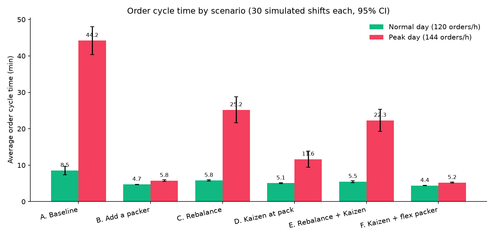
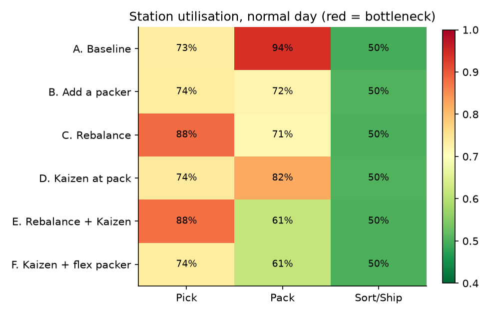
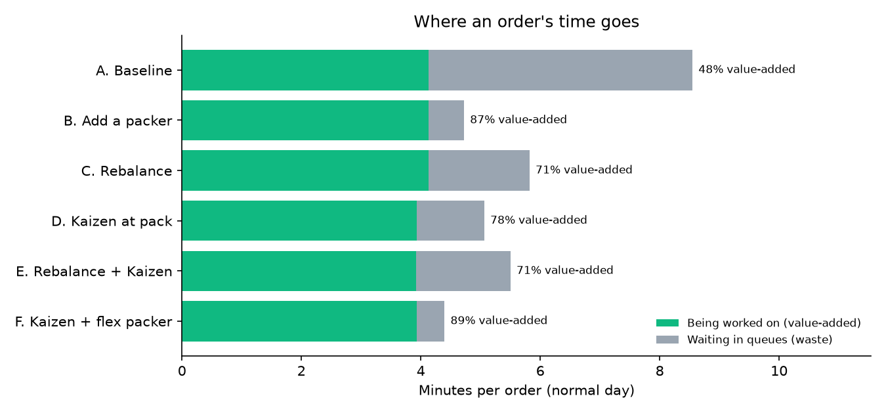

# Fulfilment Centre Simulation: Finding and Fixing the Bottleneck

A discrete-event simulation of an e-commerce order fulfilment line (**Pick → Pack → Sort/Ship**) built with Python and SimPy, using **illustrative (assumed) parameters, not company data**. It finds the bottleneck, tests six improvement scenarios over **30 simulated shifts each** with 95% confidence intervals, stress-tests them at **+20% peak demand**, and is validated against queueing theory with 17 automated tests.

**In plain terms:** the pack station runs at 94% of its capacity, so small delays turn into long queues. In this model a 25% cut in pack setup time (an assumption: pre-built cartons) cuts the average order time by 41% with the same 11 staff. On a +20% peak day one extra packer is still needed.



## Key results

| | Baseline | Recommended |
|---|---|---|
| **Normal day** (120 orders/h, 11 staff) | 8.5 min average cycle time, 14.7 min p95 | **D. Kaizen at pack: 5.1 min (-41%), 8.4 min p95 (-43%), same 11 staff** |
| **Peak day** (144 orders/h) | 44.2 min average, 73.4 min p95, line falls behind (315 of 360 units/h shipped) | **F. Kaizen + 1 flex packer: 5.2 min (-88%), 8.6 min p95, ships 355 units/h** |
| **Waiting time** | Orders spend 52% of their time waiting in queues | 22% (normal day, scenario D) |
| **Bottleneck** | Pack station at 94% utilisation | Pack 82% (D), pick becomes the constraint with a flex packer (F) |

**Recommendation:** remove waste at the pack station first (no extra headcount), and add one flexible packer only on peak days.

> All parameters are **illustrative assumptions** (see `src/config.py`), not data from any company. The Kaizen effect (pack setup 0.8 → 0.6 min) is an assumed 25% improvement that would need a time study to confirm.

## The process


- Units per order: 1 + Poisson(1.5), mean 2.5
- Task times (mean, minutes): pick 1.2 + 0.4 per unit, pack 0.8 + 0.25 per unit, sort 0.5; all lognormal with 30% variability
- 60-minute warm-up discarded, then one 8-hour shift measured

## Scenarios

| | Scenario | Staff | Change |
|---|---|---|---|
| A | Baseline | 11 | 6 pick / 3 pack / 2 sort |
| B | Add a packer | 12 | +1 packer |
| C | Rebalance | 11 | move 1 picker to pack |
| D | Kaizen at pack | 11 | pre-built cartons cut pack setup from 0.8 to 0.6 min |
| E | Rebalance + Kaizen | 11 | C and D together |
| F | Kaizen + flex packer | 12 | D plus 1 packer |

## Results (30 shifts per scenario, mean ± 95% CI)

**Normal day (120 orders/h)**

| Scenario | Staff | Cycle mean (min) | Cycle p95 (min) | Value-added | Bottleneck |
|---|---|---|---|---|---|
| A. Baseline | 11 | 8.5 ± 1.1 | 14.7 ± 2.0 | 48% | Pack (94%) |
| B. Add a packer | 12 | 4.7 ± 0.1 | 7.3 ± 0.2 | 87% | Pick (74%) |
| C. Rebalance | 11 | 5.8 ± 0.2 | 10.1 ± 0.7 | 71% | Pick (88%) |
| **D. Kaizen at pack** | **11** | **5.1 ± 0.1** | **8.4 ± 0.4** | **78%** | Pack (82%) |
| E. Rebalance + Kaizen | 11 | 5.5 ± 0.3 | 9.2 ± 0.6 | 71% | Pick (88%) |
| F. Kaizen + flex packer | 12 | 4.4 ± 0.1 | 6.8 ± 0.1 | 89% | Pick (74%) |

**Peak day (144 orders/h)**

| Scenario | Cycle mean (min) | Cycle p95 (min) | Units shipped/h (demand 360) |
|---|---|---|---|
| A. Baseline | 44.2 | 73.4 | 315 |
| B. Add a packer | 5.8 | 9.5 | 358 |
| C. Rebalance | 25.2 | 40.2 | 339 |
| D. Kaizen at pack | 11.6 | 18.3 | 356 |
| E. Rebalance + Kaizen | 22.3 | 35.2 | 338 |
| **F. Kaizen + flex packer** | **5.2** | **8.6** | **355** |

Full tables: `outputs/tables/`.

## What the analysis shows

1. **The pack station is the constraint.** At 94% utilisation, small random delays pile up into long queues: orders spend more time waiting than being worked on.
2. **Moving people only moves the bottleneck.** Rebalancing (C, E) shifts the constraint to picking (88%), which collapses at peak demand.
3. **Removing waste beats adding labour on normal days.** The Kaizen (D) gets most of the benefit of an extra packer with no extra headcount.
4. **Peaks need capacity, not just efficiency.** At +20% demand only the scenarios with a fourth packer (B, F) keep up.

 

## Validation

The model is checked against queueing theory, so the numbers can be trusted within its assumptions (`tests/test_model.py`, 17 tests):

- **Little's Law** (WIP = throughput × time in system) holds within 5% for every scenario (e.g. baseline: 17.26 measured vs 17.13 predicted).
- **Utilisation** matches the theoretical offered load ρ = λ·E[S]/c within 3 percentage points at every station.
- A stable line ships what it receives; an overloaded station (ρ > 1) builds a queue; more capacity never increases cycle time; the lognormal sampler has the requested mean and variability; same seed, same result.

Scenarios use common random numbers (the same 30 seeds), so differences come from the design, not luck.

## Lean view

See the one-page **[A3 report](docs/A3_report.md)**: problem, current state, root cause, countermeasures, results and follow-up.

## Run it

```bash
python3 -m venv .venv && source .venv/bin/activate
pip install -r requirements.txt
./run_all.sh
```

Change any parameter or scenario in `src/config.py` and rerun.

## Project structure

```
src/config.py           parameters and scenarios (all assumptions in one place)
src/model.py            SimPy model and KPIs
src/run_experiments.py  30 replications per scenario, confidence intervals
src/charts.py           charts
tests/test_model.py     validation against queueing theory
docs/A3_report.md       lean A3 summary
```

## Limitations

- Parameters are assumptions, not measured data; the Kaizen effect needs a time study.
- One product family, first-come-first-served queues, no breaks, absenteeism, equipment failures or travel congestion.
- Constant arrival rate within a shift (no hourly waves).

## Tech

Python · SimPy · pandas · NumPy · matplotlib · pytest

Author: Abderrahmane Messaoudi, Industrial Engineering & Engineering Management, University of Sharjah · [LinkedIn](https://www.linkedin.com/in/abderrahmane-messaoudi-984161273/)
